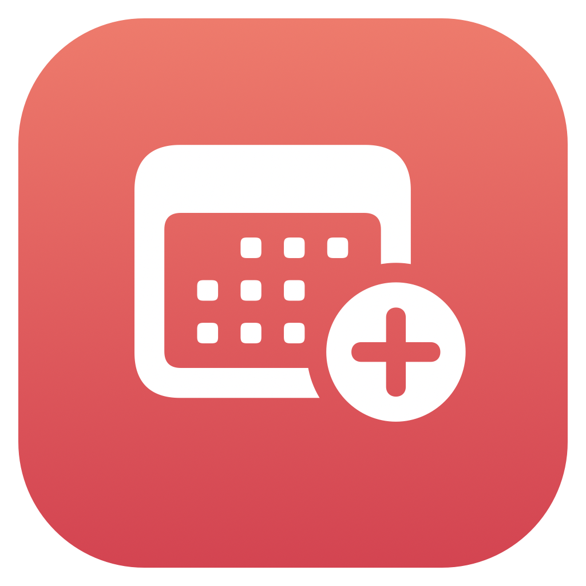

# Quick Event for Alfred

Create a calendar event from one line of plain text, right from [Alfred](https://www.alfredapp.com). Type what you would say, pick a calendar, press Enter. Works in English and Dutch.



## Install

Download `Quick Event.alfredworkflow` from the [latest release](https://github.com/dna75/alfred-quick-event/releases/latest) and double-click it. Requires the Alfred Powerpack.

## Usage

Type the keyword (default `ev`) followed by your event:

| You type | Result |
|---|---|
| `ev dentist tomorrow 2pm` | Dentist, tomorrow 14:00–15:00 |
| `ev lunch with Jan fri 12:30 +1.5h @Downtown #work` | Friday 12:30–14:00, location Downtown, in the *work* calendar |
| `ev mom's birthday 5 dec` | All-day event on 5 December (no time means all day) |
| `ev meeting 25-11 at 9:30 until 11:00 #personal` | 25 November 09:30–11:00 in the *personal* calendar |

Alfred shows a preview with the day, time and calendar. Every writable calendar is its own result, with your default calendar first; pick one with the arrow keys.

- <kbd>↩</kbd> create the event
- <kbd>⌘</kbd><kbd>↩</kbd> create the event and open Calendar

### What you can type (in any order)

| Part | Examples |
|---|---|
| Date | `today`, `tomorrow`, `mon` … `sun` (next occurrence), `next fri`, `25-11`, `25/11/2026`, `5 dec` |
| Time | `14:00`, `14.30`, `2pm`, `9:30am`, `at 14:00` |
| End | `until 15:00`, or a duration: `+1h`, `+30m`, `+1.5h` |
| Place | `@Office`; use underscores for spaces: `@Main_Street` |
| Calendar | `#work`; the start of the name is enough |
| All day | give a date without a time, or add `all day` |

Everything else becomes the title. Without a date or time, the event starts at the next full hour today. Dutch words work too (`morgen`, `vandaag`, `vr`, `om 14u30`, `tot 15:00`, `+1u`, `heledag`).

## Configuration

Alfred Preferences → Workflows → Quick Event → Configure Workflow:

| Setting | Default | Meaning |
|---|---|---|
| Keyword | `ev` | what you type in Alfred |
| Language | English | language of the texts Alfred shows (English or Nederlands) |
| Default calendar | empty | calendar listed first; empty uses the first writable calendar |
| Default duration (minutes) | 60 | used when you give no end time or duration |
| Hide calendars | `Birthdays,Holidays,Scheduled Reminders` | calendars that do not appear in the list, separated by commas |

## Requirements

- macOS with the Calendar app. The first time, macOS asks whether Alfred may control Calendar; allow it (System Settings → Privacy & Security → Automation).
- Python 3: Apple's `/usr/bin/python3` (part of the Command Line Tools). If it is missing, macOS offers to install it.

## Limitations

- The parser knows English and Dutch words and numeric dates; other languages are not recognised.
- No recurring events, alerts or invitations; the event is created with Calendar's default alert settings.
- Only calendars that are writable in the Calendar app are offered.

## Build from source

```sh
./build.sh
```

creates `Quick Event.alfredworkflow` from the `workflow/` folder.

## Disclosure

This workflow was created with the help of an AI assistant (Claude by Anthropic) and tested by the author.

## License

MIT, see [LICENSE](LICENSE).
